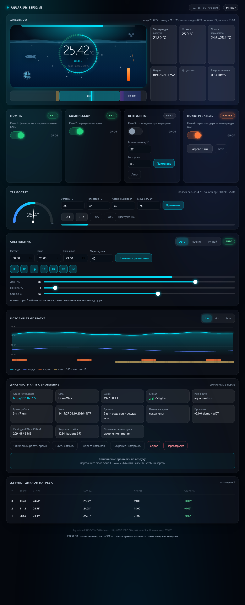

# Аквариумный контроллер на ESP32-S3 (N16R8)

Прошивка поднимает на плате веб-сервер и отдаёт живой интерфейс аквариума: светильник
с рассветом, днём, закатом и ночником, помпа, компрессор, вентилятор охлаждения и
подогреватель 75 Вт, который сам держит заданную температуру по двум DS18B20.



> Плата: модуль **ESP32-S3-WROOM-1 N16R8** — 16 МБ флеша, 8 МБ PSRAM, два ядра 240 МГц.
> Логика 3.3 В: блок реле 5 В подключается через преобразователи уровня.

---

## Что умеет

| № | Канал | Как работает |
|---|-------|--------------|
| 1 | **Помпа** (реле 1) | кнопка на сайте, состояние сохраняется после сброса питания |
| 2 | **Компрессор/аэратор** (реле 2) | кнопка на сайте, состояние сохраняется после сброса |
| 3 | **Вентилятор охлаждения** (реле 3) | автоматически при перегреве воды + ручной режим |
| 4 | **Подогреватель 75 Вт** (реле 4) | термостат: держит уставку сам, с гистерезисом и защитами |
| 5 | **Светильник** (ШИМ, один канал) | рассвет → день → закат → ночник; ночник гаснет в заданное время |

Дополнительно — то, что даёт новая плата:

* **Живой интерфейс по SSE**: страница получает телеметрию по Server-Sent Events,
  обновление мгновенное, без опроса раз в 2 секунды;
* **История температур в PSRAM**: 24 часа с шагом 15 секунд (5760 точек), выбор окна
  на графике — 1 ч / 6 ч / 24 ч;
* **Обновление прошивки по воздуху**: и через ArduinoOTA, и перетаскиванием `.bin`
  прямо на страницу;
* **Настоящий mDNS**: `http://aquarium.local` работает почти на любом устройстве;
* **Два ядра**: управление аквариумом живёт на своём ядре и не зависит от веб-сервера —
  даже если браузер зависнет на соединении, термостат и свет продолжат работать;
* **Сторожевой таймер** (30 с) перезагружает зависшую прошивку, реле при этом обесточиваются;
* **Адресный светодиод состояния** на плате: синий — подключаюсь, зелёный — всё хорошо,
  фиолетовый — точка доступа, красный — авария, голубой — идёт обновление;
* точка доступа `Aquarium` как резерв (при этом плата продолжает пытаться выйти в сеть);
* отладочные команды в мониторе порта и подробный лог: конфигурация, датчики с адресами,
  каждое переключение реле, команды с сайта, сводка раз в минуту.

### Что даёт двухъядерная плата

| Возможность | Как используется |
|---|---|
| Два ядра | контур управления на ядре 1, веб-сервер и SSE — на ядре 0 |
| 512 КБ SRAM + 8 МБ PSRAM | история температур на 24 часа в PSRAM |
| Живая телеметрия | SSE вместо опроса `/api/state` |
| mDNS | `aquarium.local` |
| Обновление прошивки | по воздуху из GitHub и через ArduinoOTA |
| Аппаратный ШИМ | LEDC, 12 бит, 5 кГц |
| NVS | настройки, расписание и данные Wi-Fi |
| Два диапазона Wi-Fi | 2,4 и 5 ГГц |

---

## Состав файлов

```
aquarium-esp32s3/
├── README.md                        этот файл
├── WIRING.md                        схема подключения, BOM, безопасность 220 В
├── WIRING.svg                       схема соединений (векторная)
├── firmware/aquarium_esp32s3/       ← это и есть скетч для Arduino IDE
│   ├── aquarium_esp32s3.ino         управление, сеть, HTTP+SSE, OTA, история
│   ├── config.h                     ВСЕ настройки: Wi-Fi, пины, уставки, расписание
│   └── webui.h                      веб-страница (хранится во флеш-памяти платы)
├── build/preview/                   как выглядит интерфейс
│   ├── ui_preview.html              автономная демонстрация (двойной клик)
│   ├── ui_desktop.png               основной вид
│   ├── ui_mobile.png                вид на телефоне
│   ├── ui_sched.png                 расписание света по дням
│   ├── ui_night.png                 ночь и ночник
│   ├── ui_alarm.png                 тревога
│   └── wiring.png                   схема соединений в PNG
├── build/prebuilt/                  прошивка и version.txt для обновления с GitHub
└── pio/                             проект PlatformIO — только для проверочной сборки
```

---

## Установка

### 1. Arduino IDE и поддержка ESP32-S3

1. Установите **Arduino IDE 2.x**.
2. *Файл → Настройки → Дополнительные ссылки для менеджера плат* добавьте:
   `https://espressif.github.io/arduino-esp32/package_esp32_index.json`
3. *Инструменты → Плата → Менеджер плат* → установите **esp32 by Espressif Systems**
   (подходит и 2.x, и 3.x — прошивка сама подстраивается под версию ядра).
4. Выберите плату **ESP32S3 Dev Module** и выставьте:

   | Параметр | Значение | Зачем |
   |----------|----------|-------|
   | **Flash Size** | `16MB (128Mb)` | весь флеш модуля |
   | **PSRAM** | `OPI PSRAM` | без этого история температур уйдёт в обычную память |
   | **Partition Scheme** | `Minimal SPIFFS (1.9MB APP with OTA/128KB SPIFFS)` | **нужен OTA**: с «16M Flash (3MB APP/9.9MB FATFS)» обновление по воздуху невозможно, там нет второго слота |
   | **USB CDC On Boot** | `Enabled` | иначе монитор порта может молчать |
   | **CPU Frequency** | `240MHz` | по умолчанию ✓ |

   > Прошивка занимает 1.07 МБ из 1.88 МБ, доступных в этой схеме разделов, — запас
   > на обновления есть. Если OTA не нужен, можно взять `16M Flash (3MB APP/9.9MB FATFS)`.

### 2. Библиотеки

*Менеджер библиотек* (Ctrl+Shift+I) → установите:

| Библиотека | Автор |
|------------|-------|
| OneWire | Paul Stoffregen |
| DallasTemperature | Miles Burton |

Всё остальное (Wi-Fi, mDNS, Preferences, Update, ArduinoOTA, LEDC) уже в ядре esp32.

### 3. Настройки

Откройте `config.h` и укажите как минимум:

```c
#define WIFI_SSID  "ВАША_СЕТЬ"     // подойдёт и 5 ГГц
#define WIFI_PASS  "ВАШ_ПАРОЛЬ"
```

Полезное рядом:

| Настройка | Зачем |
|-----------|-------|
| `WIFI_HOSTNAME "aquarium"` | имя в сети: `http://aquarium.local` |
| `USE_STATIC_IP 1` + `STATIC_IP` | постоянный адрес вместо DHCP |
| `ENABLE_OTA 1`, `ENABLE_WEB_OTA 1` | обновление прошивки по воздуху и со страницы |
| `ENABLE_SSE 1` | живая телеметрия без опроса |
| `HISTORY_HOURS 24` | глубина истории в PSRAM (можно 72 или 168 часов) |
| `LED_PWM_FREQ 5000`, `LED_PWM_BITS 12` | частота и разрядность ШИМ светильника |
| `WATCHDOG_ENABLE 1` | сторожевой таймер на 30 секунд |

### 4. Прошивка

Откройте `firmware/aquarium_esp32s3/aquarium_esp32s3.ino` и нажмите «Загрузить».
Если плата не определяется, зажмите **BOOT**, нажмите **RESET**, отпустите BOOT — появится порт.

После загрузки откройте монитор порта на **115200**: плата напечатает конфигурацию,
список датчиков и адрес интерфейса.

---

## Как найти плату в сети

1. **Монитор порта** — баннер с адресом печатается сразу после подключения и повторяется
   в сводке раз в минуту, а также каждый раз, когда вы открываете монитор.
2. **Имя в сети** — `http://aquarium.local` (настоящий mDNS). Плата также видна в списке
   клиентов роутера под именем `aquarium`.
3. **Команда `a` в мониторе порта** — плата поднимает точку доступа `Aquarium`
   (пароль `aquarium123`), интерфейс будет по адресу **http://192.168.4.1**,
   при этом попытки выйти в роутер продолжаются.
4. **Статический IP** — `USE_STATIC_IP 1` и адрес в `config.h`.

Если сеть не задана (в `config.h` осталась заглушка) или роутер не отвечает 30 секунд,
плата **сама** поднимает точку доступа и пишет об этом в монитор.

### Настройка Wi-Fi прямо в браузере

Перепрошивать плату при смене роутера больше не нужно: сеть и пароль вводятся на странице
(блок **Wi-Fi** внизу) и хранятся в энергонезависимой памяти платы.

1. Подключитесь к точке доступа `Aquarium` (пароль `aquarium123`) и откройте `http://192.168.4.1`.
2. Разверните блок **Wi-Fi**, нажмите **«Найти сети»** — плата просканирует эфир и покажет
   только те сети **2,4 ГГц**, которые видит сама (5 ГГц она не умеет — это нормально).
3. Выберите сеть из списка, введите пароль и нажмите **«Подключить»**.
4. Плата сохранит данные в память, переподключится, и через 30 секунд выключит точку доступа.
   Новый адрес будет виден в том же блоке и в разделе «Диагностика».
5. **«Забыть сеть»** — удаляет сохранённые данные и возвращает всё к значениям из `config.h`.

Если новая сеть не ответит за 45 секунд, плата снова поднимет точку доступа, чтобы не
потерять доступ к настройкам. Пароль на страницу никогда не отдаётся — только статус.

### Команды в мониторе порта

| Клавиша | Действие |
|---------|----------|
| `s` | состояние: температуры, реле, свет, тревоги |
| `i` | сеть: адрес, шлюз, RSSI, SSID, heap и PSRAM |
| `a` | поднять точку доступа |
| `w` | переподключиться к роутеру |
| `d` | список датчиков DS18B20 с адресами |
| `x` | тест реле 1…3 по очереди (нагреватель не трогает) |
| `n` | запросить время у NTP |
| `l` | режим света: авто → ночник → ручной |
| `p` / `o` / `v` | помпа / компрессор / вентилятор |
| `g` | нагрев вручную на 15 минут |
| `c` / `r` | сохранить настройки / перезагрузить |
| `h` | справка |

### Обновление прошивки по воздуху

* **Со страницы (основной способ)**: раздел «Диагностика и обновление» → **«Проверить обновление»** →
  **«Обновить с GitHub»**. Плата сама скачивает файл, показывает проценты и перезагружается.
* **Из Arduino IDE**: плата видна в списке сетевых портов (`aquarium at 192.168.x.x`)
  после включения `ENABLE_OTA`. В `config.h` задайте `ArduinoOTA.setPassword(...)` при желании.

### Обновление одной кнопкой из GitHub

В разделе «Диагностика и обновление» есть блок **«Обновление прошивки с GitHub»**:
плата сама скачивает `.bin` по ссылке из `config.h`, прошивается им и перезагружается.

1. Положите собранную прошивку в репозиторий, например
   `build/prebuilt/aquarium_esp32s3.bin` (именно этот файл уже лежит в репозитории проекта).
2. В `config.h` укажите ссылку:

   ```c
   #define ENABLE_GITHUB_OTA 1
   #define OTA_GITHUB_URL \
     "https://raw.githubusercontent.com/<логин>/<репозиторий>/main/build/prebuilt/aquarium_esp32s3.bin"
   ```

3. На странице: **«Проверить обновление»** → плата читает `build/prebuilt/version.txt`,
   показывает **найденную версию** («на GitHub: v2.3.1 — новее вашей v2.3.0») и размер файла,
   затем разрешает кнопку **«Обновить с GitHub»** → дальше идёт прогресс по процентам.

Подробности, о которых стоит знать:

* ссылка должна отдавать сам файл (raw.githubusercontent.com — да; обычная страница
  `github.com/.../blob/...` — нет, это HTML);
* прошивка должна быть собрана **для этой платы и с той же схемой разделов**
  (`Minimal SPIFFS (1.9MB APP with OTA)`), иначе обновление не встанет;
* для скачивания по HTTPS нужен доступ в интернет **из сети платы** — в режиме точки доступа
  его нет, поэтому сначала настройте Wi-Fi, потом обновляйтесь;
* проверка сертификата отключена (`setInsecure()`), чтобы не тратить 40 КБ RAM на корневые
  сертификаты. Если нужна строгая проверка — задайте `tls.setCACert(...)` в `httpOtaGithub()`;
* без GitHub прошивку можно залить через Arduino IDE или по проводу (`esptool`, PlatformIO).

## Версии и релизы

Каждая версия в репозитории помечается тегом и **релизом** с прикреплённым `.bin`:

| Версия | Что изменилось |
|--------|----------------|
| 2.3.1 | расписание начинается с понедельника, правильное определение дня недели (SNTP), кнопка «Взять время с этого устройства», убрана загрузка файла перетаскиванием |
| 2.3.0 | расписание света по дням недели, показ версии найденного обновления |
| 2.2.1 | имя сети в баннере подключения |
| 2.2.0 | настройка Wi-Fi со страницы, обновление с GitHub по кнопке |
| 2.0.0 | первый выпуск под ESP32-S3 |

Порядок выпуска: поднять `FW_VERSION` в `config.h` → собрать → положить `.bin` и `version.txt`
в `build/prebuilt/` → коммит, тег, релиз с файлом.

---

## Анимации интерфейса

Все анимации привязаны к смыслу и мгновенно показывают, что происходит с аквариумом:

| Элемент | Что делает |
|---------|------------|
| Аквариум на главной | вода с бегущими волнами, рыбка плавает, пузырьки поднимаются при работающем аэраторе |
| Крыльчатка помпы | вращается, когда помпа включена |
| Вентилятор на сцене | крутится и подсвечивается, когда идёт охлаждение |
| Подогреватель | оранжевая спираль светится, над ней поднимается тепло |
| Лампа над аквариумом | полоса заполняется по текущей яркости и светит цветом фазы |
| Кольцо температуры | «дышит», пока идёт нагрев, и во время рассвета/заката |
| Температура и показатели | плавно «догоняют» новое значение и мигают при изменении |
| Полоса суток | показывает рассвет, день, закат, ночник и текущий момент |
| Переключатели реле | плавно переезжают, светятся зелёным или оранжевым |
| Баннер тревоги | пульсирует, точка состояния дышит |
| Фон | медленно плывущие цветные пятна, оттенок меняется по фазе света |
| Ночью | палитра сама приглушается — интерфейс «засыпает» вместе с аквариумом |

Выключенный канал не анимируется вовсе — по одному взгляду на страницу понятно,
что сейчас работает.

---

## Веб-API

| Запрос | Что делает |
|--------|------------|
| `GET /` | страница управления |
| `GET /events` | **живая телеметрия (SSE)** — браузер получает состояние каждую секунду |
| `GET /api/state` | полное состояние в JSON |
| `GET /api/history?win=3600` | история: окно в секундах (3600 / 21600 / 86400) |
| `GET /api/scan` | список найденных DS18B20 с адресами и ролями |
| `GET /api/scanwifi` | поиск сетей 2,4 ГГц (текстом: `rssi|шифрование|имя` в каждой строке) |
| `GET /api/wifi?ssid=Дом&pass=пароль` | сохранить сеть в память и переподключиться |
| `GET /api/wifi?forget=1` | забыть сохранённую сеть |
| `GET /api/updcheck` | проверить прошивку на GitHub (строками: `V` версия, `N` новее?, `I` размер, `D`/`E`) |
| `GET /api/updrun` | скачать прошивку с GitHub, прошить и перезагрузиться (`P <процент>`) |
| `GET /api/cmd?pump=toggle` | помпа: `1`, `0` или `toggle` (`air`, `fan`, `heat` так же) |
| `GET /api/cmd?set=25.5&hyst=0.4&maxt=30&pw=75` | термостат |
| `GET /api/cmd?fanon=27&fanhy=0.5` | пороги вентилятора |
| `GET /api/cmd?lmode=auto` / `night` / `manual` | режим светильника |
| `GET /api/cmd?lday=0,80&lnight=0,5` | мощность дня и яркость ночника, % |
| `GET /api/cmd?lch=0&lval=60` | текущая яркость в ручном режиме |
| `GET /api/cmd?sched=1,0800,2000,2300,40;…` | **расписание по дням**: 7 групп `вкл,рассвет,закат,ночник,переход` через `;` (0 — воскресенье, 1 — понедельник) |
| `GET /api/cmd?on=08:00&off=20:00&noff=23:00&ramp=40` | быстрая правка: те же значения для всех дней |
| `GET /api/cmd?days=127` | включить/выключить дни битовой маской |
| `GET /api/cmd?water=1` | назначить датчик воды по индексу из `/api/scan` |
| `GET /api/cmd?timesync=1` | попросить время у NTP |
| `GET /api/cmd?tset=1761000000` | задать время вручную (unix-время) — так делает кнопка «Взять время с этого устройства» |
| `GET /api/cmd?conf=1` / `reset=1` / `reboot=1` | сохранить / сбросить / перезагрузить |

Примеры:

```bash
curl "http://192.168.1.50/api/cmd?heat=0"
# будни 08:00–20:00 с ночником до 23:00, выходные — выходной
curl "http://192.168.1.50/api/cmd?sched=0,0800,2000,2300,40;1,0800,2000,2300,40;1,0800,2000,2300,40;1,0800,2000,2300,40;1,0800,2000,2300,40;1,0800,2000,2300,40;0,0800,2000,2300,40"
```

---

## Как работает термостат

* Полоса термостата: `уставка ± гистерезис` (по умолчанию `25.0 ± 0.4 °C`).
* Между включениями пауза не меньше 90 секунд, минимум работы — 20 секунд.
* Защиты, работающие всегда, даже в ручном режиме:
  * нет достоверных данных о воде → нагрев выключен;
  * температура выше аварийного порога (30 °C) → нагрев выключен, включается вентилятор,
    повтор через 10 минут и только после остывания на 1.5 °C;
  * непрерывный нагрев дольше 45 минут → аварийное отключение с блокировкой.
* Ручное включение с сайта — на 15 минут, дальше автоматика вернётся сама.
* Вентилятор включается при `27.0 °C` (порог настраивается) и всегда при аварийном перегреве.

## Как работает светильник

```
 08:00              08:40                     19:20        20:00         23:00        08:00
   │──── рассвет ────│────────── день ─────────│── закат ────│── ночник ──│── темнота ──│
   0% → 80%                80% (режим «День»)  80% → 5%     5% (ночник)     0%        рассвет
```

* **Расписание задаётся отдельно на каждый день недели** (блок «Расписание света» на странице,
  список идёт с понедельника). У каждого дня свои рассвет, закат, «ночник до» и длительность
  перехода, плюс галочка активности — снятая галочка означает выходной, свет не включается.
* Сохраняется кнопкой **«Сохранить расписание»** и живёт в NVS платы; свет считается по
  расписанию текущего дня недели.
* «Ночник до» — время, когда ночник гаснет и светильник выключается до утра. Если поставить
  время, равное закату, ночник не включится вовсе.
* Три режима: **Авто** (по расписанию), **Ночник** (включить слабый свет сейчас),
  **Ручной** (яркость ползунком).
* ШИМ — аппаратный LEDC: 5 кГц, 12 бит (4096 ступеней), с гамма-коррекцией 2.2.

### Чтобы день недели был верным

Расписание зависит от дня недели, поэтому часам нужен настоящий источник времени:

1. **NTP** (автоматически, как только плата выйдет в сеть с интернетом). В диагностике
   источник отображается как «NTP».
2. **Кнопка «Взять время с этого устройства»** в том же разделе — берёт время из браузера
   (телефона или ПК) и сохраняет его в память платы. Это гарантирует верную дату и день недели
   даже без интернета.
3. Если ни то, ни другое ещё не произошло, в диагностике будет «время сборки» или
   «из памяти платы», а в тревогах — «Время не синхронизировано»: день недели в этом случае
   может быть неверным.

---

## Технические подробности

* **RAM:** 61 908 байт глобальных переменных из 327 680 (18 %), **Flash:** 1 208 042 байта
  из 1 966 080 доступных (61 %) — замерено вашим ядром: Arduino-ESP32 **3.3.12**
  (xtensa-esp-elf-gcc, `esp32:esp32:esp32s3` с PSRAM OPI и схемой разделов `min_spiffs`).
  Из этого ~116 КБ добавляет HTTPS-клиент для обновления с GitHub.
* Совместимость ядер: в 3.x переписаны LEDC (`ledcAttach(pin…)` вместо `ledcSetup/ledcAttachPin`),
  сторожевой таймер (IDF 5, `esp_task_wdt_config_t`) и `server.available()` → `server.accept()`.
  Все различия спрятаны в обёртках `pwmInit/pwmWrite/rgbWrite` и `#if ESP_ARDUINO_VERSION_MAJOR`,
  поэтому один и тот же скетч собирается и на 2.x, и на 3.x без правок.
* Ядра: контур управления — `loop()` на ядре 1, веб-сервер и SSE — отдельная задача на ядре 0.
  Обмен через мьютекс и очередь команд, поэтому браузер физически не может затормозить термостат.
* Настройки — в NVS через `Preferences` (запись откладывается на 20 с после изменения,
  во время OTA флеш не трогается). Там же хранятся имя и пароль сети, заданные со страницы.
  Время тоже сохраняется в NVS: если после перезагрузки сеть ещё не поднялась,
  расписание работает по последнему известному времени.
* Wi-Fi: `WiFi.setSleep(false)` — интерфейс отзывается быстрее. Точка доступа поднимается
  в режиме `WIFI_AP_STA`, то есть попытки выйти в роутер не прекращаются. После успешного
  подключения точка доступа гасится через 30 секунд, а если новая сеть не ответила за 45 секунд —
  поднимается снова.
* Сторожевой таймер задачи — 30 с; при зависании плата перезагружается, реле обесточиваются.

---

## Проверка перед сборкой железа

Хотите посмотреть интерфейс без платы — откройте в браузере
`build/preview/ui_preview.html` (двойной клик): страница полностью рабочая, данные выдуманные.

Быстрая проверка на живой плате: в `build/prebuilt/aquarium_esp32s3.bin` лежит собранная
прошивка с настройками-заглушками — она сама поднимет точку доступа `Aquarium`
(пароль `aquarium123`) и будет доступна по `http://192.168.4.1`. Прошить можно прямо
со страницы текущей прошивки или через `esptool`/PlatformIO.

Прошивка проверена компиляцией **двумя ядрами**:
* Arduino-ESP32 **3.3.12** (та, что ставится сейчас из менеджера плат) — через `arduino-cli`:
  ошибок нет, предупреждений в нашем коде нет, 1 067 018 байт (54 %);
* Arduino-ESP32 **2.0.17** (PlatformIO, `platform = espressif32@6.9.0`) — 882 121 байт.

Единственные предупреждения обеих сборок — внутри библиотеки OneWire. На реальном железе
прошивка ещё не запускалась: перед подключением 220 В пройдите раздел
«Порядок сборки и проверки» в `WIRING.md`.

> Если планируете обновлять прошивку по воздуху — проверьте, что в Arduino IDE выбран
> раздел `Minimal SPIFFS (1.9MB APP with OTA)`: с однослотовыми схемами разделов
> `Update.begin()` вернёт ошибку, потому что второго слота под новую прошивку нет.
