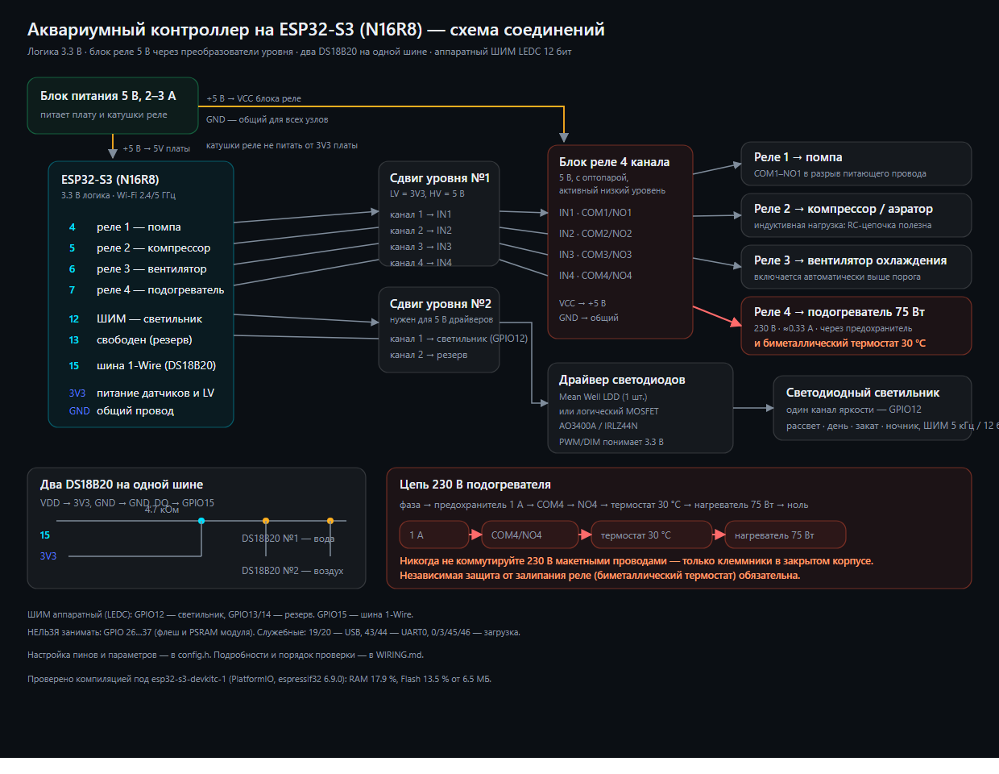

# Схема подключения аквариумного контроллера на ESP32-S3 (N16R8)



Документ описывает сборку целиком: питание, сдвиг уровней, блок реле, два DS18B20,
диммирование светильника и правила безопасности при работе с 220 В.

> **Главное про ESP32-S3:** логика платы — **3.3 В** (как у прежней MKR), поэтому вся обвязка
> остаётся: блок реле 5 В с оптопарой подключается через преобразователи уровня 3.3→5 В,
> DS18B20 питаются от 3V3. Меняются только номера выводов.
>
> **Не трогайте GPIO 26…37** — они заняты флеш-памятью и PSRAM модуля N16R8.
> GPIO 19/20 — USB, 43/44 — UART0 (монитор порта), 0/3/45/46 — служебные при загрузке.

---

## 1. Что нужно купить (BOM)

| # | Компонент | Кол-во | Примечание |
|---|-----------|:------:|------------|
| 1 | Плата **ESP32-S3 N16R8** (DevKitC-1) | 1 | 16 МБ флеша, 8 МБ PSRAM, USB-C |
| 2 | Преобразователь уровня 3.3↔5 В | 2 | 4-канальный, BSS138 или TXS0108E |
| 3 | Блок реле 4 канала, 5 В, с оптопарой | 1 | **активный низкий уровень** |
| 4 | DS18B20 в гильзе (вода) | 1 | кабель 1–3 м |
| 5 | DS18B20 (воздух) | 1 | TO-92 или в гильзе |
| 6 | Резистор 4.7 кОм, 0.25 Вт | 1 | подтяжка шины 1-Wire к 3V3 |
| 7 | Блок питания 5 В, 2–3 А | 1 | питает плату и катушки реле |
| 8 | MOSFET-модуль под 3.3 В (AO3400 / IRLZ44N) | 1 | либо драйвер Mean Well LDD |
| 9 | Резистор 100 Ом и 10 кОм | по 2 | в затвор и затвор–исток |
| 10 | Предохранитель 1 А + держатель | 1 | в фазном проводе нагрузки 220 В |
| 11 | Биметаллический термостат 30–32 °C | 1 | **аварийная защита подогревателя, обязательна** |
| 12 | Клеммники, гильзы, корпус | — | 220 В — только в закрытом корпусе |
| 13 | (опция) SSR-10DA | 1 | вместо механического реле для подогревателя |

Опционально: вентилятор, помпа, компрессор — они коммутируются контактами реле.

---

## 2. Распределение выводов

| GPIO | Функция | Куда идёт |
|------|---------|-----------|
| **4** | реле 1 — помпа | сдвиг уровня №1, канал 1 → `IN1` |
| **5** | реле 2 — компрессор/аэратор | сдвиг уровня №1, канал 2 → `IN2` |
| **6** | реле 3 — вентилятор охлаждения | сдвиг уровня №1, канал 3 → `IN3` |
| **7** | реле 4 — подогреватель 75 Вт | сдвиг уровня №1, канал 4 → `IN4` |
| **12** | ШИМ — светильник | сдвиг уровня №2 (если нужен 5 В) → MOSFET/драйвер |
| **13, 14** | резерв | второй и третий канал, если появится многоканальная лампа |
| **15** | шина 1-Wire | `DQ` обоих DS18B20 + резистор 4.7 кОм на **3V3** |
| **16** | (опция) ШИМ вентилятора | MOSFET, включается `FAN_PWM_ENABLE 1` |
| **17** | (опция) пищалка | `BUZZER_ENABLE 1` |
| **48** | встроенный адресный светодиод платы | индикация состояния, ничего подключать не нужно |
| **8, 9** | I²C по умолчанию платы | свободны для расширений (SDA/SCL) |
| 19, 20 | USB (D−/D+) | не занимать |
| 43, 44 | UART0 | монитор порта, не занимать |
| 0, 3, 45, 46 | служебные при загрузке | не занимать |
| **26…37** | флеш и PSRAM модуля | **нельзя использовать** |
| 1, 2, 10, 11, 18, 21, 38, 47 | свободны | под датчик уровня воды, pH, кнопки |

ШИМ аппаратный (LEDC): 5 кГц, 12 бит. Настраивается в `config.h`
(`LED_PWM_FREQ`, `LED_PWM_BITS`) — для драйверов Mean Well LDD можно снизить до 1 кГц.

---

## 3. Питание

```
        USB-C 5 В  или  блок питания 5 В / 2–3 А
                 │
        ┌────────┴─────────┐
        │                  │
   5V/VIN (плата)     VCC блока реле
        │                  │
       GND ─────────────── GND   ← общий провод обязателен
```

* Плата питается по **USB-C** (5 В) или от внешнего 5 В на вывод **5V/VIN**.
* **Катушки реле нельзя питать от 3V3 платы** — только от 5 В.
* От 3V3 питаются только DS18B20 и логическая сторона преобразователей уровня.
* Если хотите гальваническую развязку реле: снимите перемычку **JD-VCC** и подайте на
  `JD-VCC` отдельные 5 В, оставив `VCC` от платы.
* Общий провод платы, преобразователей, блока реле, драйверов и блока питания —
  **обязательно соединён**, иначе ШИМ и логика работать не будут.
* ⚠️ ESP32-S3 чувствителен к просадкам питания: при щелчках реле от слабого USB-порта
  плата может перезагружаться. Питайте реле от отдельного 5 В и добавьте электролит
  470–1000 мкФ рядом с блоком реле.

---

## 4. Преобразователи уровня (level shifter)

| Модуль | Куда |
|--------|------|
| `LV` | **3V3** платы |
| `LV1…LV4` | выводы GPIO 4…7 |
| `GND` (LV) | GND платы |
| `HV` | **5 В** |
| `HV1…HV4` | входы `IN1…IN4` блока реле |
| `GND` (HV) | GND блока питания |

Входы блока реле активны низким уровнем: пока ESP32 не инициализировался, подтяжки
преобразователя держат входы в 5 В — реле **выключены**, включая подогреватель.
Это и есть правильное безопасное состояние при включении питания.

**Модуль №2** нужен, если драйвер света или модуль MOSFET рассчитаны на 5-вольтовую логику
(например, IRF520). Если используете логический MOSFET под 3.3 В (AO3400A, IRLZ44N, IRLML2502)
или драйвер Mean Well LDD, второй модуль можно оставить в резерве.

Чего делать не стоит: пропускать через сдвиг уровня шину 1-Wire (DS18B20 работает от 3.3 В),
использовать сдвиг уровня для питания нагрузки, подавать 5 В на GPIO напрямую.

---

## 5. Блок реле

| Клемма | Куда |
|--------|------|
| `VCC` | +5 В |
| `GND` | GND (общий) |
| `IN1` | сдвиг уровня №1, канал 1 (GPIO4) — помпа |
| `IN2` | канал 2 (GPIO5) — компрессор |
| `IN3` | канал 3 (GPIO6) — вентилятор |
| `IN4` | канал 4 (GPIO7) — подогреватель |
| `COM` / `NO` / `NC` | силовая часть: нагрузка между `COM` и `NO` |

Нагрузка подключается **в разрыв** питающего провода: фаза → предохранитель → `COM`,
`NO` → нагрузка → ноль.

В `config.h` за полярность отвечает `RELAY_ACTIVE_LOW`:
`1` (по умолчанию) — стандартный модуль с оптопарой; `0` — если у вашего модуля наоборот
(тогда мультиметром проверьте, что при загрузке платы подогреватель **выключен**).

---

## 6. Датчики DS18B20

```
   3V3 ──┬───────────────┬───────────────┐
         │               │               │
        4.7к            DS18B20 №1      DS18B20 №2
         │             (вода)           (воздух)
 GPIO15 ─┴───────────────┴───────────────┘
   GND ──────────────────┴───────────────┘
```

* Три провода: `VDD` → 3V3, `GND` → GND, `DQ` → **GPIO15**.
* Подтягивающий резистор 4.7 кОм — **один на всю шину**.
* Оба датчика на одной шине, различаются адресом. По умолчанию первый найденный — вода,
  второй — воздух. Назначить конкретный: «Найти датчики» на странице, затем
  `http://<ip>/api/cmd?water=0` (или `1`).
* Кабель воды не прокладывайте рядом с сетевыми 220 В. Для длины больше 3 м — экранированный.

---

## 7. Диммирование светодиодного светильника

Яркостью управляет **один ШИМ-выход GPIO12** — светильник одноцветный, управления спектром нет.
GPIO 13 и 14 остаются свободными на случай многоканальной лампы.

### Вариант A (рекомендуется): драйвер Mean Well LDD-350H / 700H / 1000H
* Вход `PWM/DIM` понимает 3.3 В логику; ШИМ 5 кГц подходит (при желании снизьте
  `LED_PWM_FREQ` до 1000 в `config.h`).
* Ток стабилизирован, КПД высокий. Схема: `GPIO12 → PWM`, общий GND, питание светодиодов
  от отдельного блока 12/24/36 В.

### Вариант B: логический MOSFET (бюджетно)
* Подходят AO3400A, IRLML2502, IRLZ44N. MOSFET — **в разрыв минуса** ленты:
  `+12 В → лента → сток`, `исток → GND`, `затвор → GPIO12`, резистор 100 Ом в затвор,
  10 кОм между затвором и истоком.
* Минус питания ленты соединяется с GND платы — иначе ШИМ не заработает.

### Вариант C: через второй сдвиг уровня
Только для 5-вольтовых модулей (IRF520). `GPIO12 → LV1 → HV1 → вход модуля`.

---

## 8. Безопасность при работе с 220 В

1. **Предохранитель 1 А** в фазном проводе — обязательно.
2. **Все сетевые соединения — только винтовыми клеммами** в закрытом корпусе.
3. **Биметаллический термостат 30–32 °C последовательно с нагревателем** — независимая
   защита на случай залипания контактов реле.
4. **УЗО 10–30 мА** в щитке и заземление оборудования — сильная рекомендация рядом с водой.
5. Механическое реле имеет ресурс ~100 000 срабатываний; прошивка держит гистерезис 0.4 °C
   и паузу ≥90 с, но для подогревателя лучше **SSR-10DA**.
6. Для компрессора и помпы (индуктивная нагрузка) полезен RC-снаббер или варистор
   параллельно контактам.
7. Низковольтные провода разводите отдельно от сетевых, пересечения — под 90°.

---

## 9. Порядок сборки и проверки

1. Соберите низковольтную часть **без** подключения 220 В.
2. Прозвоните: 3V3–GND и 5 В–GND не должны быть в коротком замыкании.
3. Подайте 5 В, не подключая нагрузку. Светодиоды всех четырёх каналов реле должны быть **погашены**.
4. Откройте монитор порта (115200). В норме:
   `Aquarium ESP32-S3 v2.0.0 · ESP32-S3 (N16R8)`, причина перезагрузки, ядра/флеш/PSRAM,
   список датчиков и адрес интерфейса.
5. Проверьте встроенный светодиод платы: синий — подключается, зелёный — работает,
   фиолетовый — точка доступа, красный — авария.
6. Зайдите на страницу, пощёлкайте реле по очереди, проверьте показания датчиков
   (сравните с бытовым термометром, допуск ±0.5 °C).
7. Проверьте свет: ручной режим, ползунок — яркость меняется плавно, без мерцания.
8. **Только после этого** подключайте 220 В: сначала подогреватель с термостатом.

---

## 10. Частые ошибки

| Симптом | Причина |
|---------|---------|
| Плата не определяется, порта нет | зажмите **BOOT**, нажмите **RESET**, отпустите BOOT |
| Монитор порта молчит | не включено **USB CDC On Boot: Enabled** в настройках платы |
| Плата перезагружается при щелчке реле | питание от слабого USB или общее с катушками — подайте отдельные 5 В + 1000 мкФ |
| В логе нет PSRAM / история пропала | в Arduino IDE не выбран **PSRAM: OPI PSRAM** |
| Не компилируется, ошибки про пины | заняты GPIO 26…37 (флеш/PSRAM) — используйте распиновку выше |
| Не открывается `aquarium.local` | mDNS не поддержан устройством — откройте по IP |
| `station mode` не подключается | сеть 5 ГГц с WPA3? включите 2.4 ГГц или смешанный режим |
| Реле щёлкают «наоборот» | не тот `RELAY_ACTIVE_LOW`, либо перепутаны `IN`-каналы |
| Подогреватель включается при загрузке | модуль реле с активным высоким уровнем — нужен модуль с оптопарой |
| Температура −127 °C или 85 °C | нет резистора 4.7 кОм / обрыв / не тот вывод DQ |
| Свет не диммируется | MOSFET с 5-вольтовым затвором без сдвига уровня, либо нет общего GND |
| Не знаю адрес платы | монитор порта, `http://aquarium.local`, список клиентов роутера или команда `a` |
