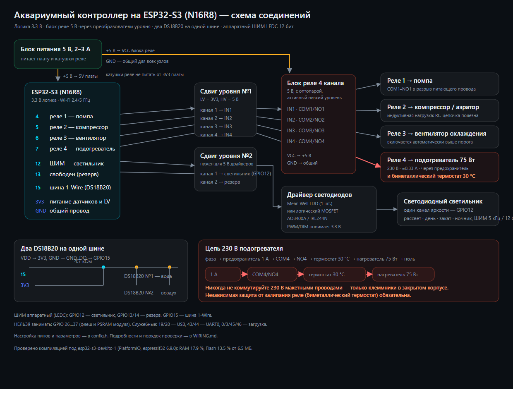

# Схема подключения аквариумного контроллера на ESP32-S3 (N16R8)



Документ описывает сборку целиком: питание, сдвиг уровней, блок реле, два DS18B20,
диммирование светильника и правила безопасности при работе с 220 В.

> **Главное про ESP32-S3:** логика платы — **3.3 В**, поэтому вся обвязка
> остаётся: блок реле 5 В с оптопарой подключается через преобразователи уровня 3.3→5 В,
> DS18B20 питаются от 3V3. Меняются только номера выводов.
>
> **Не трогайте GPIO 26…37** — они заняты флеш-памятью и PSRAM модуля N16R8.
> GPIO 19/20 — USB, 43/44 — UART0 (монитор порта), 0/3/45/46 — служебные при загрузке.

---

## 1. Что нужно купить (BOM)

| # | Компонент | Кол-во | Примечание |
|---|-----------|:------:|------------|
| 1 | Плата **ESP32-S3 N16R8** (DevKitC-1) | 1 | 16 МБ флеша, 8 МБ PSRAM, USB-C |
| 2 | Преобразователь уровня 3.3↔5 В | 2 | 4-канальный, BSS138 или TXS0108E |
| 3 | Блок реле 4 канала, 5 В, с оптопарой | 1 | **активный низкий уровень** |
| 4 | DS18B20 в гильзе (вода) | 1 | кабель 1–3 м |
| 5 | DS18B20 (воздух) | 1 | TO-92 или в гильзе |
| 6 | Резистор 4.7 кОм, 0.25 Вт | 1 | подтяжка шины 1-Wire к 3V3 |
| 7 | Блок питания 5 В, 2–3 А | 1 | питает плату и катушки реле |
| 8 | LED-драйвер с входом диммирования **или** понижающий LDD-700H, **или** IRL540N + радиатор | 1 | для выхода 24–60 В постоянного тока (см. раздел 7) |
| 9 | Резистор 100 Ом и 10 кОм | по 2 | в затвор и затвор–исток |
| 10 | Предохранитель 1 А + держатель | 1 | в фазном проводе нагрузки 220 В |
| 11 | Биметаллический термостат 30–32 °C | 1 | **аварийная защита подогревателя, обязательна** |
| 12 | Клеммники, гильзы, корпус | — | 220 В — только в закрытом корпусе |
| 13 | (опция) SSR-10DA | 1 | вместо механического реле для подогревателя |

Опционально: вентилятор, помпа, компрессор — они коммутируются контактами реле.

---

## 2. Распределение выводов

| GPIO | Функция | Куда идёт |
|------|---------|-----------|
| **4** | реле 1 — помпа | сдвиг уровня №1, канал 1 → `IN1` |
| **5** | реле 2 — компрессор/аэратор | сдвиг уровня №1, канал 2 → `IN2` |
| **6** | реле 3 — вентилятор охлаждения | сдвиг уровня №1, канал 3 → `IN3` |
| **7** | реле 4 — подогреватель 75 Вт | сдвиг уровня №1, канал 4 → `IN4` |
| **12** | ШИМ — светильник | сдвиг уровня №2 (если нужен 5 В) → MOSFET/драйвер |
| **13, 14** | резерв | второй и третий канал, если появится многоканальная лампа |
| **15** | шина 1-Wire | `DQ` обоих DS18B20 + резистор 4.7 кОм на **3V3** |
| **16** | (опция) ШИМ вентилятора | MOSFET, включается `FAN_PWM_ENABLE 1` |
| **17** | (опция) пищалка | `BUZZER_ENABLE 1` |
| **48** | встроенный адресный светодиод платы | индикация состояния, ничего подключать не нужно |
| **8, 9** | I²C по умолчанию платы | свободны для расширений (SDA/SCL) |
| 19, 20 | USB (D−/D+) | не занимать |
| 43, 44 | UART0 | монитор порта, не занимать |
| 0, 3, 45, 46 | служебные при загрузке | не занимать |
| **26…37** | флеш и PSRAM модуля | **нельзя использовать** |
| 1, 2, 10, 11, 18, 21, 38, 47 | свободны | под датчик уровня воды, pH, кнопки |

ШИМ аппаратный (LEDC): 5 кГц, 12 бит. Настраивается в `config.h`
(`LED_PWM_FREQ`, `LED_PWM_BITS`) — для драйверов Mean Well LDD можно снизить до 1 кГц.

---

## 3. Питание

```
        USB-C 5 В  или  блок питания 5 В / 2–3 А
                 │
        ┌────────┴─────────┐
        │                  │
   5V/VIN (плата)     VCC блока реле
        │                  │
       GND ─────────────── GND   ← общий провод обязателен
```

* Плата питается по **USB-C** (5 В) или от внешнего 5 В на вывод **5V/VIN**.
* **Катушки реле нельзя питать от 3V3 платы** — только от 5 В.
* От 3V3 питаются только DS18B20 и логическая сторона преобразователей уровня.
* Если хотите гальваническую развязку реле: снимите перемычку **JD-VCC** и подайте на
  `JD-VCC` отдельные 5 В, оставив `VCC` от платы.
* Общий провод платы, преобразователей, блока реле, драйверов и блока питания —
  **обязательно соединён**, иначе ШИМ и логика работать не будут.
* ⚠️ ESP32-S3 чувствителен к просадкам питания: при щелчках реле от слабого USB-порта
  плата может перезагружаться. Питайте реле от отдельного 5 В и добавьте электролит
  470–1000 мкФ рядом с блоком реле.

---

## 4. Преобразователи уровня (level shifter)

| Модуль | Куда |
|--------|------|
| `LV` | **3V3** платы |
| `LV1…LV4` | выводы GPIO 4…7 |
| `GND` (LV) | GND платы |
| `HV` | **5 В** |
| `HV1…HV4` | входы `IN1…IN4` блока реле |
| `GND` (HV) | GND блока питания |

Входы блока реле активны низким уровнем: пока ESP32 не инициализировался, подтяжки
преобразователя держат входы в 5 В — реле **выключены**, включая подогреватель.
Это и есть правильное безопасное состояние при включении питания.

**Модуль №2** нужен, если драйвер света или модуль MOSFET рассчитаны на 5-вольтовую логику
(например, IRF520 или модуль с оптопарой). Если используете логический MOSFET IRL540N (100 В, 0.044 Ом)
или драйвер Mean Well LDD, второй модуль можно оставить в резерве.

Чего делать не стоит: пропускать через сдвиг уровня шину 1-Wire (DS18B20 работает от 3.3 В),
использовать сдвиг уровня для питания нагрузки, подавать 5 В на GPIO напрямую.

---

## 5. Блок реле

| Клемма | Куда |
|--------|------|
| `VCC` | +5 В |
| `GND` | GND (общий) |
| `IN1` | сдвиг уровня №1, канал 1 (GPIO4) — помпа |
| `IN2` | канал 2 (GPIO5) — компрессор |
| `IN3` | канал 3 (GPIO6) — вентилятор |
| `IN4` | канал 4 (GPIO7) — подогреватель |
| `COM` / `NO` / `NC` | силовая часть: нагрузка между `COM` и `NO` |

Нагрузка подключается **в разрыв** питающего провода: фаза → предохранитель → `COM`,
`NO` → нагрузка → ноль.

В `config.h` за полярность отвечает `RELAY_ACTIVE_LOW`:
`1` (по умолчанию) — стандартный модуль с оптопарой; `0` — если у вашего модуля наоборот
(тогда мультиметром проверьте, что при загрузке платы подогреватель **выключен**).

---

## 6. Датчики DS18B20

```
   3V3 ──┬───────────────┬───────────────┐
         │               │               │
        4.7к            DS18B20 №1      DS18B20 №2
         │             (вода)           (воздух)
 GPIO15 ─┴───────────────┴───────────────┘
   GND ──────────────────┴───────────────┘
```

* Три провода: `VDD` → 3V3, `GND` → GND, `DQ` → **GPIO15**.
* Подтягивающий резистор 4.7 кОм — **один на всю шину**.
* Оба датчика на одной шине, различаются адресом. По умолчанию первый найденный — вода,
  второй — воздух. Назначить конкретный: «Найти датчики» на странице, затем
  `http://<ip>/api/cmd?water=0` (или `1`).
* Кабель воды не прокладывайте рядом с сетевыми 220 В. Для длины больше 3 м — экранированный.

---

## 7. Диммирование светодиодного светильника

Яркостью управляет **один ШИМ-выход GPIO12** — светильник одноцветный, управления спектром нет.
GPIO 13 и 14 остаются свободными на случай многоканальной лампы.

> ⚠️ **Если у драйвера светильника на выходе 24–60 В постоянного тока** (например, 230 В AC → 55 В DC),
> то обычные «модули MOSFET» на IRF520/IRLZ44N/AO3400 сюда **не годятся**: IRF520 не является
> логическим ключом (его 0.27 Ом нормируются при 10 В на затворе, а при 3.3–5 В он открывается
> в 5–10 раз хуже), AO3400A рассчитан на 30 В, IRLZ44N — ровно на 55 В без запаса.
> При токе 0.7–1 А такой ключ рассеивает 1.5–3 Вт и раскаляется до 120 °C.
> Ниже — три правильных схемы, сверху вниз по предпочтению.

### Вариант A (лучший): диммировать сам драйвер

Многие драйверы для LED имеют вход **DIM+ / DIM−** (0–10 В или PWM). Управлять надо им, а не
выходом драйвера:

```
GPIO12 ──► оптопара/повторитель (если 0–10 В) ──► DIM+ драйвера
GND    ──► DIM−
```

* 3.3 В ШИМ подаётся на вход PWM-диммирования напрямую (большинство драйверов понимают 3.3–10 В),
  для 0–10 В нужен простой повторитель на одном транзисторе или готовый модуль 3.3→10 В.
* Ток через светодиоды стабилизирован драйвером, КПД максимальный, ключ на 55 В не нужен вообще.
* В `config.h` при желании поставьте `LED_PWM_FREQ 1000`.

### Вариант B (очень хороший): понижающий LED-драйвер с ШИМ-входом

Между 55 В и светодиодами ставится драйвер-понижатель с входом диммирования:

* **Mean Well LDD-700H / LDD-1000H** (вход 6–60 В, ШИМ/0–10 В, ток 700/1000 мА) — лучший выбор;
* либо модуль на HV9910/AL8860/MP24894 с входом PWM и входом ≥60 В.

```
драйвер 55 В DC ──► LDD Vin+ / Vin−
LDD LED+ / LED− ──► светодиоды
GPIO12 ─────────► LDD DIM     (общий GND обязателен)
```

* Для LDD ШИМ лучше 100–1000 Гц: в `config.h` `LED_PWM_FREQ 1000`.
* Полярность как в прошивке: `DIM` = 3.3 В → светит, 0 В → погашен.

### Вариант C: ключ на стороне 55 В (если другого выхода нет)

Требования к транзистору: **logic-level** и **Vds ≥ 100 В** с запасом по току.

| Параметр | Значение |
|----------|----------|
| Транзистор | **IRL540N** (100 В, 28 А, 0.044 Ом при 5 В на затворе) — рабочая лошадка |
| Затвор | 100 Ом последовательно + 10 кОм на исток (притяжка к земле) |
| Драйв затвора | **5 В** через второй сдвиг уровня; при 3.3 В IRL540N открывается хуже, растёт нагрев |
| ШИМ | 200–500 Гц (`LED_PWM_FREQ 200`), чтобы медленный затвор не грелся на переключениях |
| Защита | предохранитель по току светодиодов, радиатор на транзистор, 55 В держать от платы подальше |

```
55 В + ──► светодиоды ──► сток
исток ──► GND (общий с платой и драйвером)
затвор ──► 100 Ом ──► GPIO12 (через сдвиг 3.3→5 В), 10 кОм затвор–исток
```

**Не делайте так:** модуль на IRF520 (не logic-level, без радиатора, плата рассчитана на ~24 В),
диммирование по входу 230 В драйвера, ключ в плюсовом проводе светодиодов.

### Какие готовые модули подходят при выходе драйвера 24–60 В

| Модуль | Паспорт | Для 55 В |
|--------|---------|----------|
| «MOS Module» MH на IRF520 (красная плата, SIG/VCC/GND) | ~24 В, 2 А | ❌ не открывается от 3.3 В, греется |
| **XY-MOS / XY-GMOS** (оптрон EL817, XL7005A) | **5–36 В**, 15 А, 400 Вт | ⚠️ напряжение сверх паспорта — только если транзисторы на плате ≥60 В |
| Модуль на **IRL540N** (100 В) или «MOS module 12–60 В» | 60–100 В | ✅ да |
| Диодно-транзисторный модуль «IRF3205 12–60 В» | 55–60 В | ⚠️ без запаса |

Правило: **смотрите не на надпись «400 Вт», а на максимальное напряжение нагрузки в паспорте**
и на маркировку силового транзистора (D2PAK/TO-220). Для 55 В нужен транзистор **≥60 В**,
лучше 100 В, и обязательно с драйвером затвора (или logic-level + 5 В), иначе он будет греться.

### Как за минуту отличить подходящий модуль по фото и описанию

1. **Есть ли подстроечный резистор (синий кругляш)?** Если да — скважность задаёт он, вход только
   включает/выключает. Для ШИМ с платы такой модуль не годится.
2. **Написано ли «самоблокировка» / «фиксация» / «импульс включает, повторный выключает»?**
   Это защёлка (latch): диммировать нельзя, только вкл/выкл.
3. **Есть ли в описании «PWM», «ШИМ», «частота до 1–20 кГц»?** Только такой модуль пропускает
   ШИМ насквозь.
4. **Максимальное напряжение нагрузки в паспорте** ≥ 60 В и **маркировка транзистора** (проверьте
   по фото товара: IRL540N/HY4008/NCE6005 — можно, 30–40-вольтовые для 55 В нельзя).
5. **Есть ли оптопара** (EL817/PC817): с ней земля платы развязана от 55 В — безопаснее.

---

## 8. Безопасность при работе с 220 В

### Сначала проверьте изоляцию драйвера светильника

Дешёвые LED-драйверы часто **без гальванической развязки**: выход «55 В DC» у них привязан
к сетевому проводу. Соединив минус светильника с GND платы, вы подаёте на ESP32 сетевой
потенциал — это опасно и убивает плату.

Проверка мультиметром при **выключенном** светильнике (режим сопротивления):

1. Щуп на сетевой вывод драйвера (L или N), второй — на **плюс** выхода.
   Должно быть «бесконечно» (единицы МОм и выше). Если единицы–десятки кОм — развязки нет.
2. То же между сетевым выводом и **минусом** выхода.
3. Если перед драйвером стоит блок-трансформатор (AC/AC adaptor) — развязку даёт он, это хорошо.

Если развязки нет: ставьте трансформаторный блок перед драйвером, либо меняйте драйвер на
изолированный, либо управляйте через оптопару и **не соединяйте земли**. С таким светильником
нельзя работать, держась за воду в аквариуме.

1. **Предохранитель 1 А** в фазном проводе — обязательно.
2. **Все сетевые соединения — только винтовыми клеммами** в закрытом корпусе.
3. **Биметаллический термостат 30–32 °C последовательно с нагревателем** — независимая
   защита на случай залипания контактов реле.
4. **УЗО 10–30 мА** в щитке и заземление оборудования — сильная рекомендация рядом с водой.
5. Механическое реле имеет ресурс ~100 000 срабатываний; прошивка держит гистерезис 0.4 °C
   и паузу ≥90 с, но для подогревателя лучше **SSR-10DA**.
6. Для компрессора и помпы (индуктивная нагрузка) полезен RC-снаббер или варистор
   параллельно контактам.
7. Низковольтные провода разводите отдельно от сетевых, пересечения — под 90°.

---

## 9. Порядок сборки и проверки

1. Соберите низковольтную часть **без** подключения 220 В.
2. Прозвоните: 3V3–GND и 5 В–GND не должны быть в коротком замыкании.
3. Подайте 5 В, не подключая нагрузку. Светодиоды всех четырёх каналов реле должны быть **погашены**.
4. Откройте монитор порта (115200). В норме:
   `Aquarium ESP32-S3 v2.0.0 · ESP32-S3 (N16R8)`, причина перезагрузки, ядра/флеш/PSRAM,
   список датчиков и адрес интерфейса.
5. Проверьте встроенный светодиод платы: синий — подключается, зелёный — работает,
   фиолетовый — точка доступа, красный — авария.
6. Зайдите на страницу, пощёлкайте реле по очереди, проверьте показания датчиков
   (сравните с бытовым термометром, допуск ±0.5 °C).
7. Проверьте свет: ручной режим, ползунок — яркость меняется плавно, без мерцания.
8. **Только после этого** подключайте 220 В: сначала подогреватель с термостатом.

---

## 10. Частые ошибки

| Симптом | Причина |
|---------|---------|
| Плата не определяется, порта нет | зажмите **BOOT**, нажмите **RESET**, отпустите BOOT |
| Монитор порта молчит | не включено **USB CDC On Boot: Enabled** в настройках платы |
| Плата перезагружается при щелчке реле | питание от слабого USB или общее с катушками — подайте отдельные 5 В + 1000 мкФ |
| В логе нет PSRAM / история пропала | в Arduino IDE не выбран **PSRAM: OPI PSRAM** |
| Не компилируется, ошибки про пины | заняты GPIO 26…37 (флеш/PSRAM) — используйте распиновку выше |
| Не открывается `aquarium.local` | mDNS не поддержан устройством — откройте по IP |
| `station mode` не подключается | сеть 5 ГГц с WPA3? включите 2.4 ГГц или смешанный режим |
| Реле щёлкают «наоборот» | не тот `RELAY_ACTIVE_LOW`, либо перепутаны `IN`-каналы |
| Подогреватель включается при загрузке | модуль реле с активным высоким уровнем — нужен модуль с оптопарой |
| Температура −127 °C или 85 °C | нет резистора 4.7 кОм / обрыв / не тот вывод DQ |
| Свет не диммируется | MOSFET с 5-вольтовым затвором без сдвига уровня, либо нет общего GND |
| MOSFET модуля раскаляется | IRF520/AO3400 не подходят для 24–60 В: не logic-level и не держат напряжение — см. раздел 7 (нужен IRL540N или LDD + радиатор) |
| Не знаю адрес платы | монитор порта, `http://aquarium.local`, список клиентов роутера или команда `a` |
