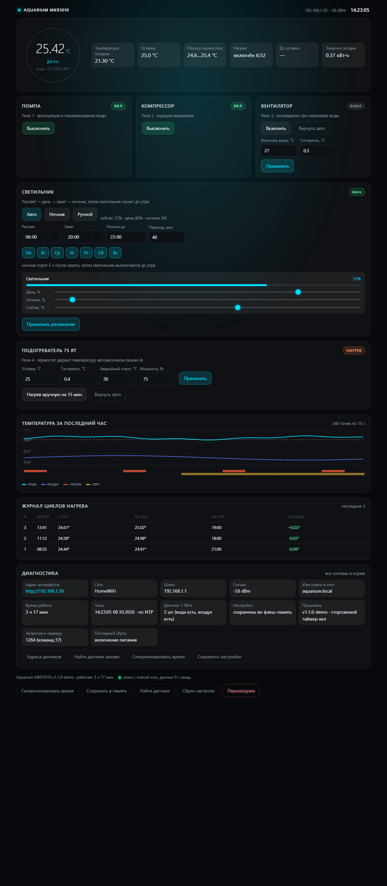

# Аквариумный контроллер на Arduino MKR WiFi 1010

Прошивка поднимает на плате веб-сервер и отдаёт сайт управления аквариумом:
светильник с рассветом, днём, закатом и ночником, помпа, компрессор, вентилятор охлаждения
и подогреватель 75 Вт, который сам держит заданную температуру по двум DS18B20.



---

## Что умеет

| № | Канал | Как работает |
|---|-------|--------------|
| 1 | **Помпа** (реле 1) | кнопка на сайте, состояние сохраняется после сброса питания |
| 2 | **Компрессор/аэратор** (реле 2) | кнопка на сайте, состояние сохраняется после сброса |
| 3 | **Вентилятор охлаждения** (реле 3) | автоматически при перегреве воды выше порога + ручной режим |
| 4 | **Подогреватель 75 Вт** (реле 4) | термостат: держит уставку сам, с гистерезисом и защитами |
| 5 | **Светильник** (ШИМ, один канал) | рассвет → день → закат → **ночник**; мощность дня и яркость ночника в процентах, ночник гаснет в заданное время |

Дополнительно:

* два датчика DS18B20 — температура воды и воздуха;
* часы реального времени + синхронизация по NTP (расписание света работает по настоящему времени);
* график температур за последний час и журнал циклов нагрева (старт, конец, длительность, ошибка);
* счётчик расхода электроэнергии подогревателем за сутки;
* тревоги: нет датчика воды, перегрев, слишком долгий нагрев, нет времени NTP;
* **подробный лог в мониторе порта**: конфигурация при старте, поиск датчиков с адресами,
  ход подключения к Wi-Fi, баннер с адресом интерфейса, каждое переключение реле, команды
  с сайта, срабатывания защит и сводка состояния раз в минуту. При открытии монитора позже
  всё печатается заново;
* **карточка «Диагностика» на сайте**: адрес, сеть, шлюз, RSSI, имя в сети, время работы,
  источник времени, датчики, состояние сохранения настроек, счётчик запросов, причина
  последней перезагрузки и индикатор живой связи («данные 2 с назад»);
* **точка доступа как резерв**: плата поднимает Wi-Fi `Aquarium` (адрес `192.168.4.1`), если
  не нашла роутер, если связь потеряна дольше 5 минут или если в `config.h` осталась сеть-заглушка.
  Команда `a` в мониторе поднимает её вручную — спасательный вариант, когда адрес потерялся;
* **сторожевой таймер**: при зависании прошивки плата перезагружается сама (реле обесточиваются);
* **имя в сети** `aquarium` (часто доступно как `http://aquarium.local`) и возможность задать
  статический IP вместо DHCP;
* отладочные команды через монитор порта, если сети нет вообще.

---

## Состав файлов

```
aquarium-mkr1010/
├── README.md                        этот файл
├── WIRING.md                        схема подключения, BOM, безопасность 220 В
├── WIRING.svg                       схема соединений (векторная)
├── firmware/aquarium_mkr1010/       ← это и есть скетч для Arduino IDE
│   ├── aquarium_mkr1010.ino         логика: термостат, свет, Wi-Fi, веб-сервер
│   ├── config.h                     ВСЕ настройки: Wi-Fi, пины, уставки, расписание
│   ├── webui.h                      веб-страница (хранится во флеш-памяти платы)
│   └── nvm.h                        сохранение настроек во флеш-память SAMD21
├── build/preview/                   как выглядит сайт (без железа)
│   ├── ui_preview.html              автономная демонстрация интерфейса
│   ├── ui_preview.png               обычный режим (день)
│   ├── ui_preview_night.html/.png   режим «Ночник» после заката
│   ├── ui_preview_alarm.html/.png   режим тревоги
│   └── wiring.png                   схема соединений в PNG
├── build/prebuilt/                  собранная прошивка (.bin) для быстрой проверки
└── pio/                             проект PlatformIO — только для проверочной сборки
```

---

## Установка

### 1. Arduino IDE и плата

1. Установите **Arduino IDE 2.x**.
2. *Инструменты → Плата → Менеджер плат* → найдите **Arduino MKR WiFi 1010** (пакет `Arduino SAMD Boards`)
   и установите.
3. Выберите плату **Arduino MKR WiFi 1010** и порт.

### 2. Библиотеки

*Менеджер библиотек* (Ctrl+Shift+I) → установите:

| Библиотека | Автор |
|------------|-------|
| OneWire | Paul Stoffregen |
| DallasTemperature | Miles Burton |
| RTCZero | Arduino |

Библиотека **WiFiNINA** отдельно ставить не нужно — она идёт вместе с платой MKR WiFi 1010.
Библиотека EEPROM не нужна: настройки сохраняются своим кодом (`nvm.h`) напрямую во флеш-память.

### 3. Настройки

Откройте `config.h` и укажите как минимум:

```c
#define WIFI_SSID  "ВАША_СЕТЬ_2.4ГГц"   // только 2.4 ГГц!
#define WIFI_PASS  "ВАШ_ПАРОЛЬ"
```

Полезные настройки рядом:

| Настройка | Зачем |
|-----------|-------|
| `WIFI_HOSTNAME "aquarium"` | имя платы в сети (видно в роутере, часто доступно как `aquarium.local`) |
| `USE_STATIC_IP 1` + `STATIC_IP` | постоянный адрес вместо DHCP — когда нужно всегда знать IP |
| `AP_FALLBACK 1`, `AP_ON_LOST_MS` | своя точка доступа, если роутера нет или связь потерялась |
| `WATCHDOG_ENABLE 1` | сторожевой таймер: при зависании плата перезагрузится и снимет нагрев |
| `LOG_HEARTBEAT_MS 60000` | как часто печатать сводку в монитор порта |
| `LED_CHANNELS 1` | один канал яркости (светильник без управления спектром) |

Проверьте остальное: часовой пояс (`TZ_OFFSET_MIN`, Москва = `180`), уставку температуры
(`DEF_SETPOINT`), расписание света и мощность дня/ночника (`DEF_DAY_PCT_1`, `DEF_NIGHT_PCT_1`).
Пины менять не нужно, если вы собираете схему по `WIRING.md`.

### 4. Прошивка

Откройте `firmware/aquarium_mkr1010/aquarium_mkr1010.ino` и нажмите «Загрузить».
После загрузки откройте монитор порта на **115200** — плата напечатает конфигурацию,
список датчиков и адрес веб-интерфейса. Что именно вы увидите и как искать плату в сети,
если монитор открыли позже, — в разделе «Как найти плату в сети» ниже.

---

## Как работает термостат

* Полоса термостата: `уставка ± гистерезис` (по умолчанию `25.0 ± 0.4 °C`).
  Ниже нижней границы реле включается, выше верхней — выключается.
* Между включениями выдерживается пауза не меньше 90 секунд, минимальная длительность
  включения — 20 секунд: механическое реле не щёлкает без нужды.
* Защиты, которые работают **всегда**, даже в ручном режиме:
  * нет достоверных данных о температуре воды → нагрев выключен;
  * температура выше аварийного порога (30 °C) → нагрев выключен, включается вентилятор,
    повтор разрешён только через 10 минут и только после остывания на 1.5 °C;
  * непрерывный нагрев дольше 45 минут → аварийное отключение с той же блокировкой.
* Включать нагрев вручную с сайта можно на 15 минут — дальше автоматика вернётся сама.
* Вентилятор включается при `27.0 °C` (порог настраивается) и всегда при аварийном перегреве.

---

## Как работает светильник

Светильник простой, одноцветный — управляется один канал яркости (ШИМ на D4).
Мощность в процентах задаётся отдельно для дня и для ночника.

```
 08:00              08:40                     19:20        20:00         23:00        08:00
   │──── рассвет ────│────────── день ─────────│── закат ────│── ночник ──│── темнота ──│
   0% → 80%                80% (режим «День»)  80% → 5%     5% (ночник)     0%        рассвет
```

Ночник — это слабый свет после заката на заданное время. Он **гаснет в указанное время**
(поле «Ночник до», по умолчанию 23:00), после чего светильник полностью выключен до утра.
Если «Ночник до» совпадает со временем заката — ночник не включается вовсе.

Три режима управления (кнопки в карточке «Светильник»):

| Режим | Что делает |
|-------|------------|
| **Авто** | по расписанию: рассвет → день → закат → ночник, затем темнота до утра |
| **Ночник** | включает яркость ночника прямо сейчас, не дожидаясь заката |
| **Ручной** | яркость задаётся ползунком, автоматика отключается до возврата в «Авто» |

Что настраивается на сайте:

* **День, %** — мощность освещения в дневном режиме (по умолчанию 80 %);
* **Ночник, %** — яркость ночника (по умолчанию 5 %; поставьте 0, чтобы ночник не горел);
* **Ночник до** — время, когда ночник гаснет и светильник выключается до утра (по умолчанию 23:00).
  Под полями интерфейс пишет, сколько ночник будет гореть: «ночник горит 3 ч после заката…»;
* время рассвета и заката, длительность перехода, дни недели;
* **Сейчас, %** — ручная яркость для режима «Ручной».

Кривая рассвета — smoothstep, а ШИМ проходит гамма-коррекцию 2.2, поэтому свет нарастает
плавно, без рывка в начале. Частота ШИМ — около 732 Гц (стандарт `analogWrite` на SAMD21).

Если время не синхронизировано по NTP, плата работает по времени компиляции прошивки и
показывает предупреждение в интерфейсе.

Если в будущем появится многоканальная лампа, поставьте в `config.h` `LED_CHANNELS 2` или `3`
и задайте подписи каналов — интерфейс сам покажет отдельные ползунки дня и ночника на каждый канал.

---

## Анимации интерфейса

Все анимации привязаны к смыслу поля и мгновенно показывают, что происходит с аквариумом:

| Элемент | Что делает |
|---------|------------|
| Температура, воздух, энергия, время нагрева | значение подсвечивается, когда меняется — видно, что плата отвечает |
| Кольцо температуры | «дышит», пока идёт нагрев, и во время рассвета/заката |
| Помпа (ВКЛ) | под карточкой текут полосы воды |
| Компрессор (ВКЛ) | поднимаются пузырьки воздуха |
| Вентилятор (ВКЛ) | вращается крыльчатка |
| Подогреватель (ВКЛ) | снизу поднимается тёплое свечение, бейдж пульсирует оранжевым |
| Бейджи ВКЛ | мягко светятся зелёным |
| Тревога | баннер пульсирует (красный — критично, янтарный — предупреждение) |
| Индикатор связи | точка пульсирует, когда данные свежие |

Выключенный канал не анимируется вовсе — по одному взгляду на страницу понятно,
что сейчас работает.

---

## Как найти плату в сети и убедиться, что всё работает

Плата громко сообщает о себе в **мониторе порта (115200 бод)**. Откройте его — вы увидите
примерно такое:

```
============================================================
   Aquarium MKR1010  v1.2.0   ·   Arduino MKR WiFi 1010
   причина перезагрузки: включение питания
============================================================
[nvm] настройки загружены из флеш-памяти
[датчики] найдено устройств 1-Wire: 2
  №0  28FF64A1B2C3D4E5  → вода (по нему работает термостат)
  №1  28FF9F0A1B2C3D4E6  → воздух
[time] часы: 08.10.2026 14:23 (до связи с NTP — время компиляции)

--- конфигурация ---
  прошивка        : Aquarium MKR1010 v1.2.0
  Wi-Fi сеть      : HomeWiFi
  реле            : помпа D0, компрессор D1, вентилятор D2, нагреватель D3
  светильник      : D4, каналов 1, 08:00-20:00, переход 40 мин, день 80%, ночник 5% до 23:00 (3 ч), дальше темнота
  термостат       : 25.0 ± 0.4 °C, аварийный порог 30.0 °C, 75 Вт
  вентилятор      : включать выше 27.0 °C
  настройки       : загружены из флеш-памяти

[wifi] подключаюсь к сети "HomeWiFi" ... 
[wifi] подключено к "HomeWiFi", IP 192.168.1.50, RSSI -58 dBm

============================================================
  ВЕБ-СЕРВЕР РАБОТАЕТ — подключение к роутеру выполнено
------------------------------------------------------------
  Откройте в браузере:   http://192.168.1.50
  плата видна в роутере как "aquarium", часто работает http://aquarium.local
  если адрес не подходит — отправьте в это окно букву 'a',
  плата поднимет свою точку доступа Aquarium
============================================================
```

Дальше в логе видно всё, что происходит: каждое переключение реле, команды с сайта,
срабатывания защит и раз в минуту — сводка:

```
[отч] 14:31:07  вода 25.42°C  воздух 21.30°C  уставка 25.0°C
      реле: помпа ВКЛ  компрессор ВКЛ  вентилятор выкл  нагрев ВКЛ  свет 72% (day)
      http://192.168.1.50  RSSI -58 dBm  работает 0 ч 8 мин  запросов 42
[реле] канал 4 нагреватель выкл  (вода 25.41 °C, уставка 25.0 °C)
```

Если монитор открыли позже — не страшно: как только порт открывается, плата печатает
конфигурацию, адрес, список датчиков и справку по командам заново.

**Способы найти адрес платы, по порядку:**

1. **Монитор порта** — баннер с адресом печатается сразу после подключения и повторяется
   в каждой сводке раз в минуту.
2. **Список клиентов роутера** — плата регистрируется под именем `aquarium`
   (настраивается `WIFI_HOSTNAME` в `config.h`). Многие роутеры отдают её и как `http://aquarium.local`.
3. **Команда `a` в мониторе порта** — если адрес потерялся, плата поднимет свою точку доступа
   `Aquarium` (пароль `aquarium123`), интерфейс будет по адресу **http://192.168.4.1**.
   Через 5 минут она сама попробует вернуться в сеть роутера.
4. **Статический IP** — включите `USE_STATIC_IP 1` в `config.h` и задайте адрес: тогда он
   всегда один и тот же.

Если сеть роутер не дал вообще (или в `config.h` осталась сеть-заглушка), плата **сама**
поднимает точку доступа и пишет об этом в монитор — ждать ничего не нужно.

**Команды в мониторе порта** (одна буква + Enter):

| Клавиша | Действие |
|---------|----------|
| `s` | состояние: температуры, уставка, реле, свет, тревоги |
| `i` | сеть: адрес, шлюз, RSSI, статус, счётчик запросов, откуда настройки |
| `a` | поднять свою точку доступа (спасательный вариант, если адрес потерялся) |
| `w` | переподключиться к роутеру |
| `d` | список датчиков DS18B20 с адресами и ролями |
| `x` | тест реле 1…3 по очереди (нагреватель не трогает) |
| `n` | синхронизировать время по NTP |
| `l` | режим света: авто → ночник → ручной |
| `p` / `o` / `v` | помпа / компрессор / вентилятор вкл-выкл |
| `c` / `r` | сохранить настройки / перезагрузить |
| `h` | справка |

**В самом интерфейсе** внизу есть карточка «Диагностика»: адрес, сеть, шлюз, уровень сигнала,
имя в сети, время работы, источник времени, число найденных датчиков, состояние сохранения
настроек, версия прошивки со сторожевым таймером, счётчик запросов и причина последней
перезагрузки. Там же зелёный индикатор «связь с платой есть, данные N с назад».

Встроенный светодиод платы (D6) мигает: **редко** — всё в порядке, **часто** — нет сети,
**очень часто** — авария (перегрев, нет датчика воды, нагрев выключен по таймеру).

---

## Веб-API (пригодится для автоматизации)

| Запрос | Что делает |
|--------|------------|
| `GET /` | страница управления |
| `GET /api/state` | полное состояние в JSON (температуры, реле, свет, тревоги) |
| `GET /api/history` | 240 точек графика: вода, воздух, флаги реле, шаг 15 с |
| `GET /api/scan` | список найденных DS18B20 с адресами |
| `GET /api/cmd?pump=toggle` | помпа: `1`, `0` или `toggle` (`air`, `fan`, `heat` — так же) |
| `GET /api/cmd?set=25.5&hyst=0.4&maxt=30&pw=75` | уставка, гистерезис, аварийный порог, мощность |
| `GET /api/cmd?fanon=27&fanhy=0.5` | пороги вентилятора |
| `GET /api/cmd?fanauto=1` / `heatauto=1` | вернуть канал в автоматический режим |
| `GET /api/cmd?lmode=auto` / `lmode=night` / `lmode=manual` | режим светильника: авто / ночник / ручной |
| `GET /api/cmd?lch=0&lval=60` | яркость канала 0 в ручном режиме |
| `GET /api/cmd?lday=0,80` | мощность канала 0 в режиме «День», % |
| `GET /api/cmd?lnight=0,5` | яркость канала 0 в режиме «Ночник», % (0 = выключен) |
| `GET /api/cmd?on=08:00&off=20:00&noff=23:00&ramp=40&days=127` | расписание света: рассвет, закат, **до какого времени горит ночник**, переход, дни недели (`days` — битовая маска, бит0 = Вс) |
| `GET /api/cmd?water=1` | назначить датчик воды по индексу из `/api/scan` |
| `GET /api/cmd?timesync=1` | синхронизировать время по NTP |
| `GET /api/cmd?conf=1` / `reset=1` / `reboot=1` | сохранить настройки / сбросить / перезагрузить |

Команды принимаются и методом `POST` (параметры в теле запроса).
Пример автоматизации: `curl http://192.168.1.50/api/cmd?heat=0`.

---

## Технические подробности

* **RAM:** 7 664 байта из 32 768 (23.4 %), **Flash:** 116 836 байт из 262 144 (44.6 %)
  — замерено компилятором arm-none-eabi-gcc 7.2.1 для `arduino:samd` 1.8.14
  (единственное предупреждение сборки — внутри сторонней библиотеки RTCZero, наш код чистый).
* Сайт (29 КБ) лежит во флеш-памяти и отдаётся платой частями; внешние CDN не нужны,
  поэтому интерфейс работает даже без интернета. Все анимации — чистый CSS внутри страницы.
* Настройки хранятся в последней строке флеш-памяти (256 байт) с CRC и магическим числом.
  Запись откладывается минимум на 20 секунд после последнего изменения, чтобы не изнашивать флеш.
  Библиотека EEPROM при этом не нужна.
* Обмен с сервером: `/api/state` раз в 2 секунды, `/api/history` раз в 15 секунд.
  Сервер однопоточный и обрабатывает по одному клиенту — этого достаточно для телефона и ПК.
* Сторожевой таймер (WDT) SAMD21 включён с периодом 16 секунд: если прошивка зависнет,
  плата перезагрузится сама, реле при этом обесточатся — подогреватель не останется
  включённым. Причина последней перезагрузки видна в диагностике и в мониторе порта.
* Управление аквариумом не зависит от сети: термостат, свет и расписание работают даже
  при полностью пропавшем Wi-Fi (часы идут от кварцевого резонатора 32 кГц).

---

## Проверка перед сборкой железа

Хотите посмотреть интерфейс без платы — откройте в браузере
`build/preview/ui_preview.html`: страница полностью рабочая, только данные выдуманные.

Быстрая проверка на живой плате без правки настроек: в `build/prebuilt/aquarium_mkr1010.bin`
лежит уже собранная прошивка (Wi-Fi-данные в ней — заглушки из `config.h`). Через 30 секунд
без подключения к роутеру плата поднимет точку доступа **Aquarium** / `aquarium123`,
интерфейс откроется по адресу `http://192.168.4.1`. Залить бинарник можно `bossac`
(идёт в комплекте с Arduino IDE); обычный путь — просто скомпилировать скетч из `firmware/`.

Прошивка проверена компиляцией под `MKR WiFi 1010` (PlatformIO, `platform = atmelsam`,
`board = mkrwifi1010`) — ошибок и предупреждений нет. Проект для этой проверки лежит в `pio/`,
для работы он не нужен (потребуется установить PlatformIO заново). На реальном железе прошивка
ещё не запускалась: перед подключением 220 В пройдите раздел «Порядок сборки и проверки»
в `WIRING.md`.
