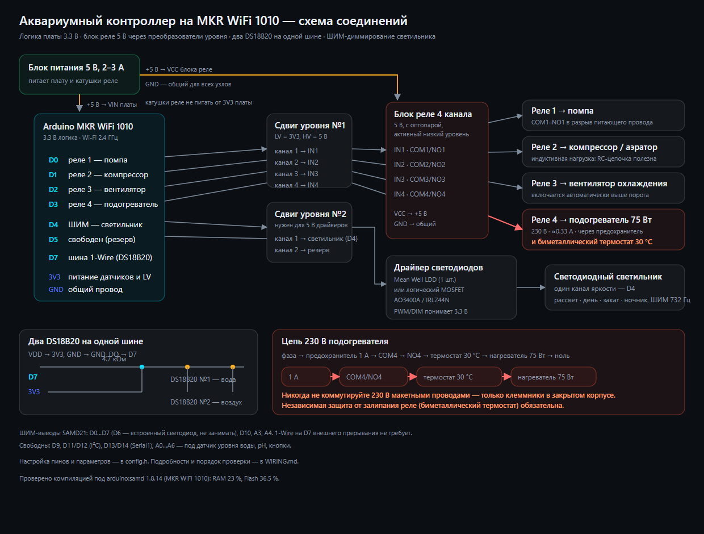

# Схема подключения аквариумного контроллера на MKR WiFi 1010



Документ описывает сборку целиком: питание, сдвиг уровней, блок реле, два DS18B20,
диммирование светодиодного светильника и правила безопасности при работе с 220 В.

> **Главное про MKR WiFi 1010:** логика платы — **3.3 В**. Все выводы (D0…D14, A0…A6)
> работают на 3.3 В и **не выдерживают 5 В**. Блок реле и любые 5-вольтовые модули
> подключаются только через преобразователь уровня. MKR WiFi 1010 — только 2.4 ГГц.

---

## 1. Что нужно купить (BOM)

| # | Компонент | Кол-во | Примечание |
|---|-----------|:------:|------------|
| 1 | Arduino MKR WiFi 1010 | 1 | платформа `arduino:samd`, плата «Arduino MKR WiFi 1010» |
| 2 | Преобразователь уровня 3.3↔5 В | 2 | 4-канальный, например на BSS138 или TXS0108E |
| 3 | Блок реле 4 канала, 5 В, с оптопарой | 1 | типа SRD-05VDC-SL-C, **активный низкий уровень** |
| 4 | DS18B20 в герметичной гильзе (вода) | 1 | с кабелем 1–3 м |
| 5 | DS18B20 обычный (воздух) | 1 | TO-92 или в гильзе |
| 6 | Резистор 4.7 кОм, 0.25 Вт | 1 | подтяжка шины 1-Wire к 3.3 В |
| 7 | Блок питания 5 В, 2–3 А | 1 | питает плату и катушки реле |
| 8 | MOSFET-модуль под 3.3 В (AO3400 / IRLZ44N) | 1 | один канал яркости; либо драйвер Mean Well LDD |
| 9 | Резистор 100 Ом и 10 кОм | по 2 | в затвор и затвор–исток (если собираете MOSFET сами) |
| 10 | Предохранитель 1 А + держатель | 1 | в фазном проводе нагрузки 220 В |
| 11 | Биметаллический термостат 30–32 °C | 1 | **аварийная защита подогревателя, обязательна** |
| 12 | Клеммники, гильзы, корпус, DIN-рейка | — | 220 В — только в закрытом корпусе |
| 13 | (опция) Твёрдотельное реле SSR-10DA | 1 | вместо механического реле для подогревателя |

Опционально: вентилятор 12/220 В, помпа, компрессор — они коммутируются контактами реле и в схему
управления не входят.

---

## 2. Распределение выводов

| Вывод MKR | Функция | Куда идёт |
|-----------|---------|-----------|
| **D0** | реле 1 — помпа | сдвиг уровня №1, канал 1 → `IN1` |
| **D1** | реле 2 — компрессор/аэратор | сдвиг уровня №1, канал 2 → `IN2` |
| **D2** | реле 3 — вентилятор охлаждения | сдвиг уровня №1, канал 3 → `IN3` |
| **D3** | реле 4 — подогреватель 75 Вт | сдвиг уровня №1, канал 4 → `IN4` |
| **D4** | ШИМ — светильник (единственный канал яркости) | сдвиг уровня №2 (если нужен 5 В) → MOSFET/драйвер |
| **D5** | свободен | второй канал, если когда-нибудь появится многоканальная лампа |
| **D6** | встроенный светодиод платы | индикация состояния (не занимать) |
| **D7** | шина 1-Wire | `DQ` обоих DS18B20 + резистор 4.7 кОм на **3V3** |
| **D8** | (опция) ШИМ вентилятора | MOSFET, включается `FAN_PWM_ENABLE 1` |
| **D10** | (опция) третий канал света | при `LED_CHANNELS 3` |
| **D9, D11–D14, A0…A6** | свободны | I²C на D11/D12, Serial1 на D13/D14; A0…A6 — под датчики уровня воды, pH, кнопки |

Скорость ШИМ на SAMD21 при `analogWrite` — около 732 Гц, это нормально и для MOSFET,
и для драйверов Mean Well LDD. Яркость дополнительно проходит гамма-коррекцию (2.2),
поэтому рассвет выглядит плавно, а не «ступенькой».

---

## 3. Питание

```
        5 В / 2–3 А блок питания
                 │
        ┌────────┴─────────┐
        │                  │
     VIN (плата)      VCC блока реле
        │                  │
       GND ─────────────── GND   ← общий провод обязателен для всех узлов
```

* Плата питается от 5 В на вывод **VIN** (или по USB при отладке).
* **Катушки реле нельзя питать от 3V3 платы** — только от 5 В блока питания.
* От 3V3 платы питаются только DS18B20 и логическая сторона преобразователей уровня.
* Если хотите гальваническую развязку реле: снимите перемычку **JD-VCC** на блоке реле
  и подайте на `JD-VCC` отдельные 5 В, оставив `VCC` от платы. Управляющие входы при этом
  по-прежнему идут через сдвиг уровня.
* Общий провод (GND) платы, преобразователей, блока реле, драйверов света и блока питания —
  **обязательно соединён**, иначе ШИМ и логика работать не будут.

---

## 4. Преобразователи уровня (level shifter)

Типовой 4-канальный модуль на BSS138:

| Модуль | Куда |
|--------|------|
| `LV` | **3V3** платы |
| `LV1…LV4` | выводы MKR (D0…D3) |
| `GND` (со стороны LV) | GND платы |
| `HV` | **5 В** блока питания |
| `HV1…HV4` | входы `IN1…IN4` блока реле |
| `GND` (со стороны HV) | GND блока питания |

Как это работает с блоком реле: входы релейного модуля с оптопарой **активны низким уровнем**.
Пока MKR не инициализировался, подтяжки преобразователя держат входы в 5 В — реле **выключены**,
в том числе подогреватель. Это и есть правильное безопасное состояние при включении питания.

**Модуль №2** нужен, если драйвер света или модуль MOSFET рассчитаны на 5-вольтовую логику
(например, популярные модули на IRF520). Если вы используете логический MOSFET под 3.3 В
(AO3400A, IRLZ44N, IRLML2502) или драйвер Mean Well LDD, второй модуль можно оставить
в резерве — например, под будущий ШИМ вентилятора, зуммер или 5-вольтовый датчик.

Чего делать не стоит:

* не пропускать через сдвиг уровня шину 1-Wire (DS18B20 прекрасно работает от 3.3 В);
* не использовать сдвиг уровня для питания нагрузки — он только для сигналов;
* не подавать 5 В на выводы MKR напрямую.

---

## 5. Блок реле

| Клемма | Куда |
|--------|------|
| `VCC` | +5 В блока питания |
| `GND` | GND (общий) |
| `IN1` | сдвиг уровня №1, канал 1 (D0) — помпа |
| `IN2` | канал 2 (D1) — компрессор |
| `IN3` | канал 3 (D2) — вентилятор |
| `IN4` | канал 4 (D3) — подогреватель |
| `COM` / `NO` / `NC` | силовая часть: нагрузка коммутируется между `COM` и `NO` |

Нагрузка подключается **в разрыв** питающего провода: фаза → предохранитель → `COM`,
`NO` → нагрузка → ноль. Ноль напрямую к нагрузке не разрывается.

В `config.h` за полярность отвечает `RELAY_ACTIVE_LOW`:

* `1` (по умолчанию) — стандартный модуль с оптопарой, вход «низкий = включено»;
* `0` — если у вашего модуля наоборот (тогда обязательно проверьте мультиметром,
  что при загрузке платы подогреватель **выключен**).

Если у модуля активный высокий уровень, при загрузке платы входы окажутся в низком уровне,
но подтяжки сдвига уровня тянут их **вверх** — то есть подогреватель может включиться
на время загрузки. С такой платой поставьте дополнительный резистор 10 кОм с каждого входа
на GND либо возьмите модуль с оптопарой и активным низким уровнем.

---

## 6. Датчики DS18B20

```
   3V3 ──┬───────────────┬───────────────┐
         │               │               │
        4.7к            DS18B20 №1      DS18B20 №2
         │             (вода)           (воздух)
   D7 ───┴───────────────┴───────────────┘
   GND ──────────────────┴───────────────┘
```

* Три провода DS18B20: `VDD` → 3V3, `GND` → GND, `DQ` → D7.
* Подтягивающий резистор 4.7 кОм — **один на всю шину**, между D7 и 3V3.
* Оба датчика висят на одной шине и различаются внутренним адресом. Прошивка по умолчанию
  считает датчиком воды первый найденный, а воздуха — второй. Чтобы назначить конкретный:
  в веб-интерфейсе нажмите «Найти датчики», посмотрите адреса и откройте
  `http://<ip-платы>/api/cmd?water=0` (или `water=1`).
* Питание — обычное (три провода), режим паразитного питания не используется.
* Кабель датчика воды не прокладывайте в одном жгуте с сетевыми 220 В проводами: наводки
  портят показания. Для длины больше 3 метров используйте экранированный/витой кабель.
* Разъём датчика воды держите вне воды и вне зоны брызг.

---

## 7. Диммирование светодиодного светильника

Яркостью управляет **один ШИМ-выход D4** — светильник одноцветный, управления спектром нет.
Вывод D5 остаётся свободным на случай, если когда-нибудь появится многоканальная лампа.
Есть три рабочих варианта подключения — выберите один.

### Вариант A (рекомендуется): драйвер Mean Well LDD-700H / LDD-1000H
* Вход `PWM/DIM` драйвера понимает 3.3 В логику, частота ШИМ 732 Гц подходит идеально.
* Ток стабилизирован, КПД высокий, светодиоды не деградируют.
* Один драйвер на канал: для одноцветного светильника нужен один (модель по току лампы —
  LDD-350H / LDD-700H / LDD-1000H).
* Схема: `D4 → PWM` драйвера, общий GND, `VIN+`/`VOUT+` — светодиодная цепь, питание
  светодиодов от отдельного блока 12/24/36 В.

### Вариант B: логический MOSFET (бюджетно)
* Подходят AO3400A, IRLML2502, IRLZ44N (у последнего при 3.3 В на затворе растёт сопротивление —
  до ~2 А без радиатора).
* MOSFET ставится **в разрыв минуса** светодиодной ленты (low-side):
  `+12 В → лента → сток`, `исток → GND`, `затвор → D4`, резистор 100 Ом в затвор,
  10 кОм между затвором и истоком.
* Минус питания ленты соединяется с GND платы — иначе ШИМ не заработает.

### Вариант C: через второй сдвиг уровня
Нужен только для 5-вольтовых MOSFET-модулей (IRF520 и подобные). Сигнал идёт
`D4 → LV1 → HV1 → затвор/вход модуля`. Помните, что такие модули медленные, а
подтяжки сдвига уровня «округляют» фронты ШИМ — для светильника это некритично.

---

## 8. Безопасность при работе с 220 В

Подогреватель 75 Вт при 230 В потребляет около 0.33 А — контакты реле 10 А справятся
с большим запасом. Опасность здесь не в токе, а в напряжении.

1. **Предохранитель 1 А** в фазном проводе — обязательно.
2. **Все сетевые соединения — только винтовыми клеммами** в закрытом корпусе.
   Макетные платы, «дюпоны» и скрутки для 220 В недопустимы.
3. **Биметаллический термостат 30–32 °C последовательно с нагревателем.** Это независимая
   защита на случай, если контакты реле залипнут: прошивка в такой ситуации уже ничем не поможет.
4. **УЗО 10–30 мА** в щитке и заземление корпуса аквариумного оборудования — сильная рекомендация
   для любого самодельного устройства рядом с водой.
5. Механическое реле имеет ресурс около 100 000 срабатываний. Прошивка держит гистерезис 0.4 °C
   и паузу не меньше 90 секунд между включениями, но для подогревателя всё равно лучше
   поставить **твёрдотельное реле SSR-10DA** — у него ресурс практически не ограничен.
6. Для компрессора и помпы (индуктивная нагрузка) полезно поставить RC-цепочку или варистор
   параллельно контактам реле — контакты проживут дольше.
7. Все низковольтные провода (датчики, ШИМ) разводите отдельно от сетевых, пересечения — под 90°.

---

## 9. Порядок сборки и проверки

1. Соберите низковольтную часть **без** подключения 220 В.
2. Прозвоните мультиметром: 3V3–GND и 5 В–GND не должны быть в коротком замыкании.
3. Подайте 5 В, не подключая нагрузку. Светодиоды всех четырёх каналов реле должны быть **погашены**.
4. Откройте монитор порта (115200 бод). В норме вы увидите:
   `=== Аквариумный контроллер ... ===`, число найденных датчиков, адрес платы в сети.
5. Зайдите в веб-интерфейс по адресу платы, по очереди пощёлкайте реле — убедитесь,
   что нужный канал включается от нужной кнопки.
6. Проверьте датчики: в интерфейсе должны появиться температуры воды и воздуха.
   Опустите датчик воды в стакан с водой комнатной температуры — показания должны совпасть
   с бытовым термометром (±0.5 °C).
7. Проверьте свет: переведите светильник в ручной режим и подвигайте ползунки — яркость
   должна меняться плавно, без мерцания.
8. **Только после этого** подключайте 220 В: сначала подогреватель с биметаллическим
   термостатом, затем остальные нагрузки.

Отладочные команды в мониторе порта: `s` — состояние, `i` — сеть, `a` — поднять точку доступа,
`w` — переподключиться к роутеру, `d` — датчики с адресами, `x` — тест реле 1…3,
`n` — синхронизация времени, `l` — режим света, `p`/`o`/`v` — помпа/компрессор/вентилятор,
`c` — сохранить, `r` — перезагрузить, `h` — справка.

Встроенный светодиод платы (D6) мигает: **редко** — всё в порядке, **часто** — нет сети,
**очень часто** — авария (перегрев, нет датчика воды, нагрев выключен по таймеру).

---

## 10. Частые ошибки

| Симптом | Причина |
|---------|---------|
| Реле щёлкают «наоборот» | не тот уровень `RELAY_ACTIVE_LOW`, либо перепутаны `IN`-каналы |
| Подогреватель включается при загрузке | модуль реле с активным высоким уровнем; нужны резисторы на GND или другой модуль |
| Плата перезагружается при щелчке реле | катушки питаются от платы/USB — подайте отдельные 5 В и общий GND |
| Температура −127 °C или 85 °C | нет подтягивающего резистора / обрыв / не тот вывод DQ |
| Датчики путаются местами | назначьте датчик воды командой `api/cmd?water=0` |
| Свет не диммируется, только вкл/выкл | MOSFET с 5-вольтовым затвором без сдвига уровня, либо нет общего GND |
| Свет мерцает | питание светодиодов от того же 5 В, что и плата; наводки от импульсного БП |
| Интерфейс не открывается | плата в режиме точки доступа (подключитесь к `Aquarium`, адрес `192.168.4.1`) |
| **Не знаю адрес платы** | монитор порта (баннер повторяется раз в минуту), список клиентов роутера по имени `aquarium` или команда `a` — плата поднимет точку доступа |
| **В логе `такая сеть не найдена`** | роутер работает в 5 ГГц или SSID написан с ошибкой; MKR WiFi 1010 видит только 2.4 ГГц |
| **Плата перезагружается сама раз в ~16 с** | сработал сторожевой таймер: причина — зависание прошивки; в логе будет `причина перезагрузки: сторожевой таймер` |
| **Свет ночью не горит** | либо «Ночник, %» = 0, либо уже прошло время «Ночник до» (по умолчанию 23:00), либо оно совпадает с закатом — тогда ночник выключен. Поднимите процент или сдвиньте «Ночник до» позже |
| Время убегает | нет доступа к NTP — смотрите предупреждение в интерфейсе, проверьте DNS/интернет |
